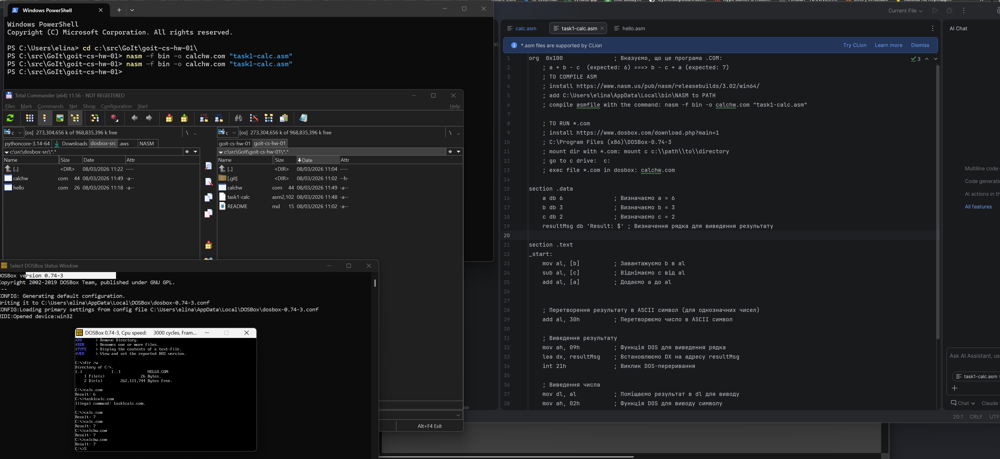
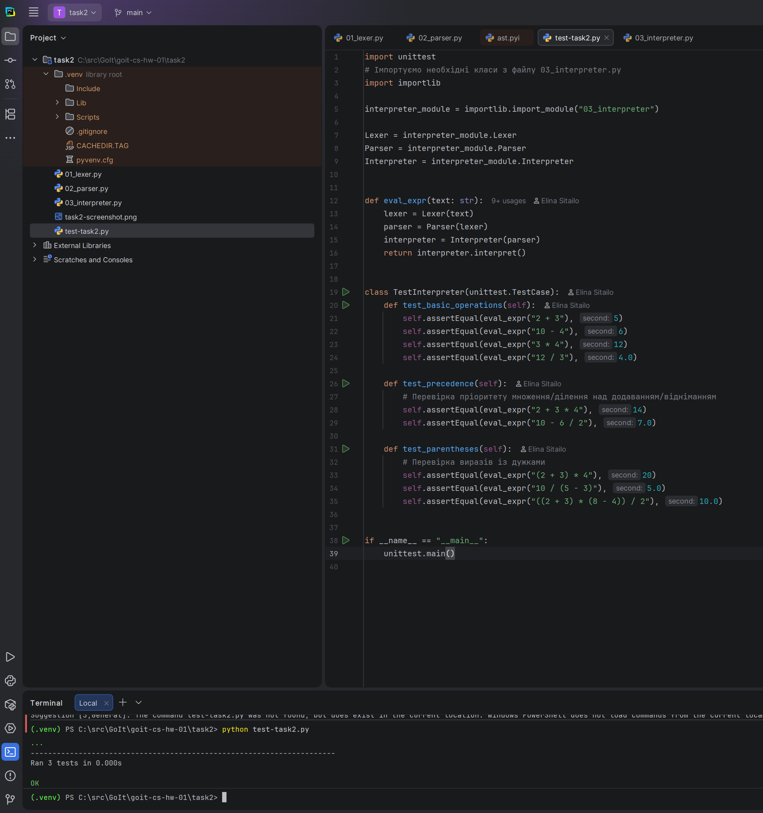

# goit-cs-hw-01 Домашнє завдання до модуля “Архітектура комп'ютерів”

* https://www.edu.goit.global/uk/learn/48407490/19336208/21155308/homework

## Завдання 1: Програма на асемблері, яка виконує обчислення арифметичного виразу b - c + a

## Завдання 2: Розширення інтерпретатора, щоб він також підтримував операції множення та ділення, та коректно обробляв вирази, що містять дужки.

